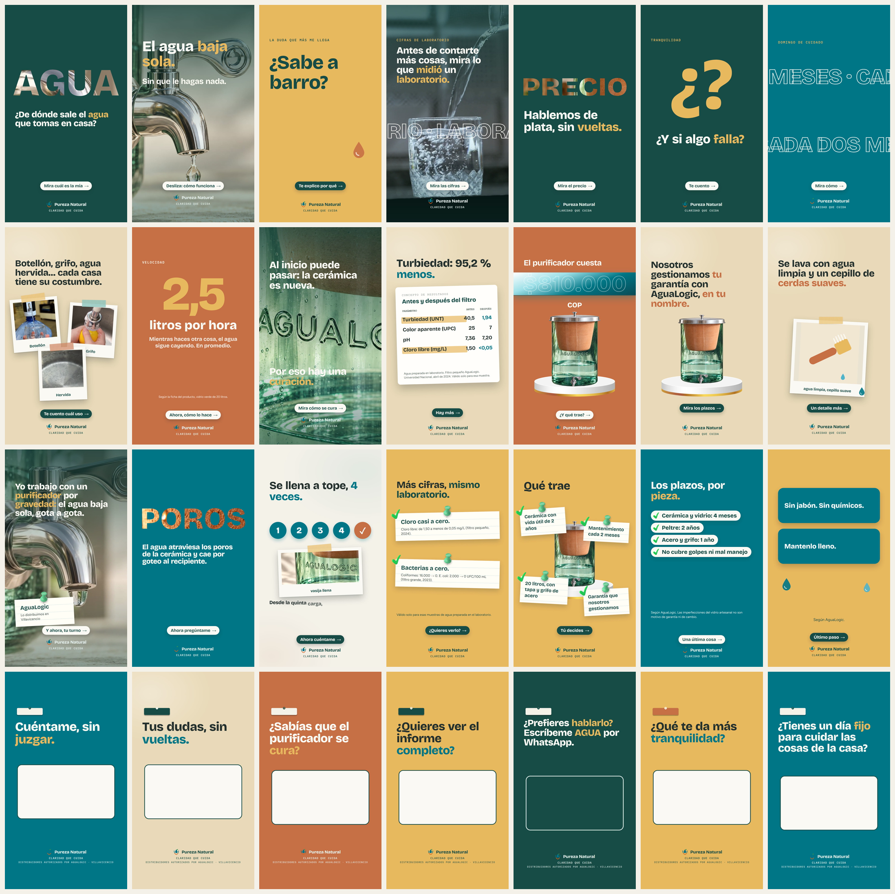
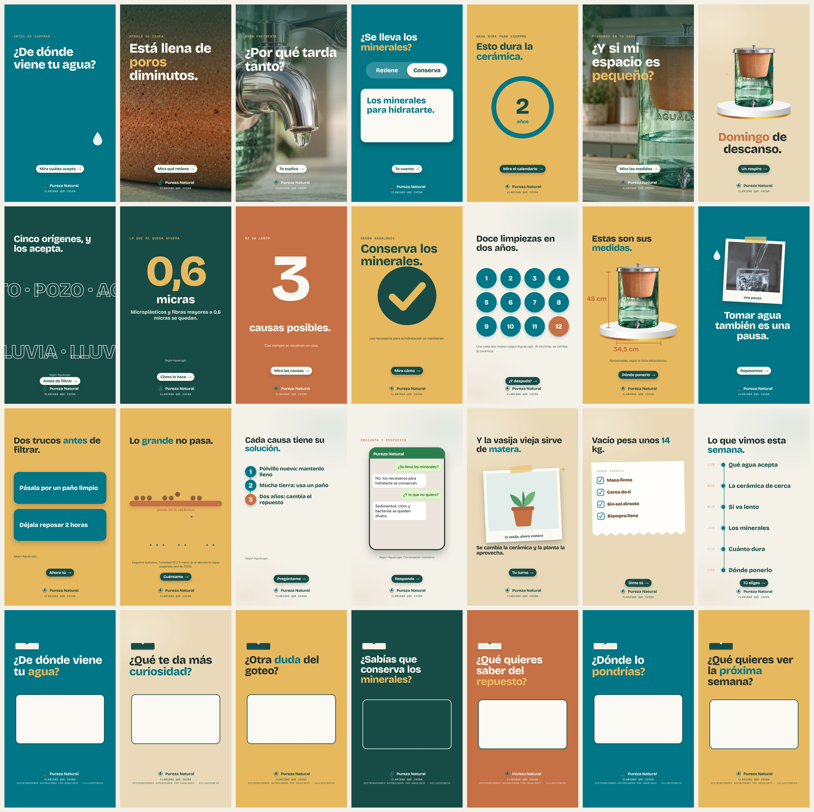
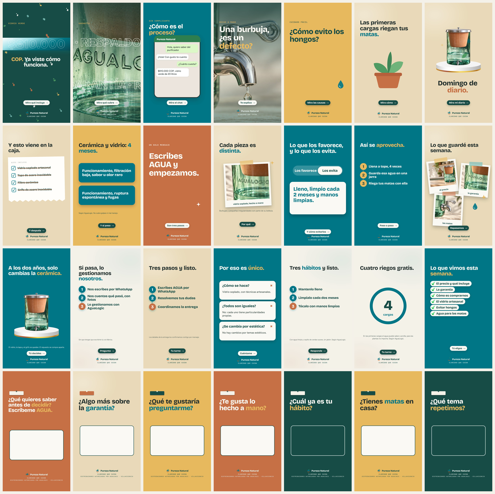
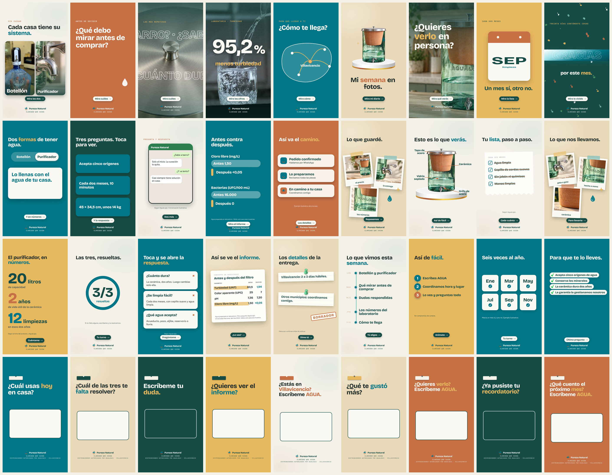

# Historias de Instagram · Pureza Natural

Claridad que cuida · Distribuidores autorizados por AguaLogic en Villavicencio, Meta.

**30 días · 120 historias animadas** (1080×1920, con música y efectos). Cada día es una secuencia de 4 historias: 1 gancho, 2 problema o resultado, 3 mecanismo y prueba, 4 llamado a la acción.

> Para ver un video: toca el enlace del día y GitHub lo reproduce en el navegador. El sticker interactivo de la historia 4 se agrega al subirla a Instagram.

## Semana 1

| Día | H1 Gancho | H2 Problema/resultado | H3 Mecanismo | H4 Llamado |
|---|---|---|---|---|
| 1 | [ver](semana-1/dia-1-historia-1.mp4) | [ver](semana-1/dia-1-historia-2.mp4) | [ver](semana-1/dia-1-historia-3.mp4) | [ver](semana-1/dia-1-historia-4.mp4) |
| 2 | [ver](semana-1/dia-2-historia-1.mp4) | [ver](semana-1/dia-2-historia-2.mp4) | [ver](semana-1/dia-2-historia-3.mp4) | [ver](semana-1/dia-2-historia-4.mp4) |
| 3 | [ver](semana-1/dia-3-historia-1.mp4) | [ver](semana-1/dia-3-historia-2.mp4) | [ver](semana-1/dia-3-historia-3.mp4) | [ver](semana-1/dia-3-historia-4.mp4) |
| 4 | [ver](semana-1/dia-4-historia-1.mp4) | [ver](semana-1/dia-4-historia-2.mp4) | [ver](semana-1/dia-4-historia-3.mp4) | [ver](semana-1/dia-4-historia-4.mp4) |
| 5 | [ver](semana-1/dia-5-historia-1.mp4) | [ver](semana-1/dia-5-historia-2.mp4) | [ver](semana-1/dia-5-historia-3.mp4) | [ver](semana-1/dia-5-historia-4.mp4) |
| 6 | [ver](semana-1/dia-6-historia-1.mp4) | [ver](semana-1/dia-6-historia-2.mp4) | [ver](semana-1/dia-6-historia-3.mp4) | [ver](semana-1/dia-6-historia-4.mp4) |
| 7 | [ver](semana-1/dia-7-historia-1.mp4) | [ver](semana-1/dia-7-historia-2.mp4) | [ver](semana-1/dia-7-historia-3.mp4) | [ver](semana-1/dia-7-historia-4.mp4) |

## Semana 2

| Día | H1 Gancho | H2 Problema/resultado | H3 Mecanismo | H4 Llamado |
|---|---|---|---|---|
| 8 | [ver](semana-2/dia-8-historia-1.mp4) | [ver](semana-2/dia-8-historia-2.mp4) | [ver](semana-2/dia-8-historia-3.mp4) | [ver](semana-2/dia-8-historia-4.mp4) |
| 9 | [ver](semana-2/dia-9-historia-1.mp4) | [ver](semana-2/dia-9-historia-2.mp4) | [ver](semana-2/dia-9-historia-3.mp4) | [ver](semana-2/dia-9-historia-4.mp4) |
| 10 | [ver](semana-2/dia-10-historia-1.mp4) | [ver](semana-2/dia-10-historia-2.mp4) | [ver](semana-2/dia-10-historia-3.mp4) | [ver](semana-2/dia-10-historia-4.mp4) |
| 11 | [ver](semana-2/dia-11-historia-1.mp4) | [ver](semana-2/dia-11-historia-2.mp4) | [ver](semana-2/dia-11-historia-3.mp4) | [ver](semana-2/dia-11-historia-4.mp4) |
| 12 | [ver](semana-2/dia-12-historia-1.mp4) | [ver](semana-2/dia-12-historia-2.mp4) | [ver](semana-2/dia-12-historia-3.mp4) | [ver](semana-2/dia-12-historia-4.mp4) |
| 13 | [ver](semana-2/dia-13-historia-1.mp4) | [ver](semana-2/dia-13-historia-2.mp4) | [ver](semana-2/dia-13-historia-3.mp4) | [ver](semana-2/dia-13-historia-4.mp4) |
| 14 | [ver](semana-2/dia-14-historia-1.mp4) | [ver](semana-2/dia-14-historia-2.mp4) | [ver](semana-2/dia-14-historia-3.mp4) | [ver](semana-2/dia-14-historia-4.mp4) |

## Semana 3

| Día | H1 Gancho | H2 Problema/resultado | H3 Mecanismo | H4 Llamado |
|---|---|---|---|---|
| 15 | [ver](semana-3/dia-15-historia-1.mp4) | [ver](semana-3/dia-15-historia-2.mp4) | [ver](semana-3/dia-15-historia-3.mp4) | [ver](semana-3/dia-15-historia-4.mp4) |
| 16 | [ver](semana-3/dia-16-historia-1.mp4) | [ver](semana-3/dia-16-historia-2.mp4) | [ver](semana-3/dia-16-historia-3.mp4) | [ver](semana-3/dia-16-historia-4.mp4) |
| 17 | [ver](semana-3/dia-17-historia-1.mp4) | [ver](semana-3/dia-17-historia-2.mp4) | [ver](semana-3/dia-17-historia-3.mp4) | [ver](semana-3/dia-17-historia-4.mp4) |
| 18 | [ver](semana-3/dia-18-historia-1.mp4) | [ver](semana-3/dia-18-historia-2.mp4) | [ver](semana-3/dia-18-historia-3.mp4) | [ver](semana-3/dia-18-historia-4.mp4) |
| 19 | [ver](semana-3/dia-19-historia-1.mp4) | [ver](semana-3/dia-19-historia-2.mp4) | [ver](semana-3/dia-19-historia-3.mp4) | [ver](semana-3/dia-19-historia-4.mp4) |
| 20 | [ver](semana-3/dia-20-historia-1.mp4) | [ver](semana-3/dia-20-historia-2.mp4) | [ver](semana-3/dia-20-historia-3.mp4) | [ver](semana-3/dia-20-historia-4.mp4) |
| 21 | [ver](semana-3/dia-21-historia-1.mp4) | [ver](semana-3/dia-21-historia-2.mp4) | [ver](semana-3/dia-21-historia-3.mp4) | [ver](semana-3/dia-21-historia-4.mp4) |

## Semana 4

| Día | H1 Gancho | H2 Problema/resultado | H3 Mecanismo | H4 Llamado |
|---|---|---|---|---|
| 22 | [ver](semana-4/dia-22-historia-1.mp4) | [ver](semana-4/dia-22-historia-2.mp4) | [ver](semana-4/dia-22-historia-3.mp4) | [ver](semana-4/dia-22-historia-4.mp4) |
| 23 | [ver](semana-4/dia-23-historia-1.mp4) | [ver](semana-4/dia-23-historia-2.mp4) | [ver](semana-4/dia-23-historia-3.mp4) | [ver](semana-4/dia-23-historia-4.mp4) |
| 24 | [ver](semana-4/dia-24-historia-1.mp4) | [ver](semana-4/dia-24-historia-2.mp4) | [ver](semana-4/dia-24-historia-3.mp4) | [ver](semana-4/dia-24-historia-4.mp4) |
| 25 | [ver](semana-4/dia-25-historia-1.mp4) | [ver](semana-4/dia-25-historia-2.mp4) | [ver](semana-4/dia-25-historia-3.mp4) | [ver](semana-4/dia-25-historia-4.mp4) |
| 26 | [ver](semana-4/dia-26-historia-1.mp4) | [ver](semana-4/dia-26-historia-2.mp4) | [ver](semana-4/dia-26-historia-3.mp4) | [ver](semana-4/dia-26-historia-4.mp4) |
| 27 | [ver](semana-4/dia-27-historia-1.mp4) | [ver](semana-4/dia-27-historia-2.mp4) | [ver](semana-4/dia-27-historia-3.mp4) | [ver](semana-4/dia-27-historia-4.mp4) |
| 28 | [ver](semana-4/dia-28-historia-1.mp4) | [ver](semana-4/dia-28-historia-2.mp4) | [ver](semana-4/dia-28-historia-3.mp4) | [ver](semana-4/dia-28-historia-4.mp4) |
| 29 | [ver](semana-4/dia-29-historia-1.mp4) | [ver](semana-4/dia-29-historia-2.mp4) | [ver](semana-4/dia-29-historia-3.mp4) | [ver](semana-4/dia-29-historia-4.mp4) |
| 30 | [ver](semana-4/dia-30-historia-1.mp4) | [ver](semana-4/dia-30-historia-2.mp4) | [ver](semana-4/dia-30-historia-3.mp4) | [ver](semana-4/dia-30-historia-4.mp4) |

Cifras de laboratorio: agua preparada en laboratorio, válidas solo para esas muestras. Repositorio privado.
